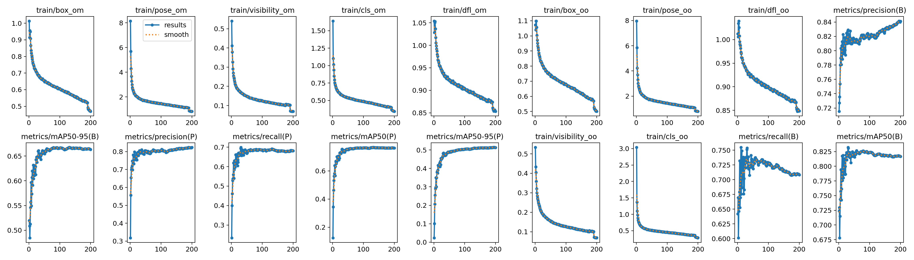
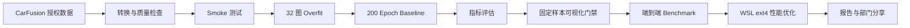
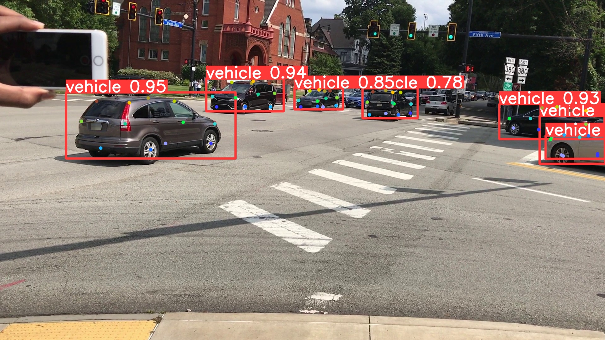

# YOLOv10 Vehicle Pose：用 Codex 构建车辆关键点训练系统

基于 [THU-MIG/YOLOv10](https://github.com/THU-MIG/yolov10) 扩展的车辆检测与关键点训练系统，面向 CarFusion 单类车辆数据。项目覆盖数据转换与质检、14×3 Pose Head、训练门禁、断点恢复、精度评估、可视化验收、端到端性能分析及部门分享材料。

> CarFusion 数据和 P5-Zero 生成权重不在本仓库中。仓库版本化代码、配置、
> 测试、JSON 证据、实验报告、可视化结果、PPT 和演讲稿；既有 baseline
> 权重仅作为历史制品保留，新生成权重不得继续提交。

## 结果概览

训练环境为 WSL2 + RTX 3090 Ti，YOLOv10n Vehicle Pose，`imgsz=640`、`batch=16`、200 epochs。

| 指标 | 结果 |
|---|---:|
| 验证集 | 3,606 images / 11,569 instances |
| Box mAP50 / mAP50-95 | 0.818 / 0.665 |
| Pose mAP50 / mAP50-95 | 0.765 / 0.515 |
| PCK@0.05 / PCK@0.10 | 0.6686 / 0.8525 |
| NME | 0.05960 |
| E 盘到 WSL ext4 端到端延迟 | 60.10 → 16.63 ms |
| 系统吞吐提升 | 3.61×，不改变模型与精度 |

完整验收结论见 [reports/09_final_acceptance.md](reports/09_final_acceptance.md)。



## 当前推荐：P5-Zero 平衡压缩

P5-Zero 是当前通过速度、精度和独立 CUDA memory 三门禁的 PyTorch
结构压缩方案，不使用 TensorRT。相对直接父模型 LitePSA+C2f-P4D1，它仅移除
backbone/neck P5 的内部 bottleneck，完整保留 P3/P4 与 Box/Class/Pose
任务塔；相对原始 baseline，它还继承了父模型的 LitePSA 和 P4 减深。

| 指标 | 原始 baseline | P5-Zero | 变化 |
|---|---:|---:|---:|
| paired fused-FP16 latency | 5.94537 ms | 5.06345 ms | **-14.83371%** |
| Box/Pose mAP50-95 | 约 0.665/0.515 | **0.66254/0.49592** | 达到发布门槛 |
| fused 参数量 | 3,992,210 | 3,387,794 | **-15.13989%** |
| 推理峰值 CUDA memory | 72,237,568 B | 68,609,024 B | **-5.02307%** |

最终学生先经过同源全模型 KD，再进行 Pose-only KD 精修；部署推理不需要
教师。Pose 门槛余量为 0.00137，因此换硬件、依赖或数据版本后必须重新执行
三门禁。

- **外部制品准备、训练、验证、测速和故障排查：**
  [README_P5ZERO.md](README_P5ZERO.md)
- **最终实验报告：**
  [reports/kernel_depth/p5zero_balance_result_20260727.md](reports/kernel_depth/p5zero_balance_result_20260727.md)
- **完整压缩实验复盘：**
  [reports/kernel_depth/experiment_review_20260727.md](reports/kernel_depth/experiment_review_20260727.md)
- **三页技术评审 PPT 与演讲稿：**
  [slide-deck/vehicle-pose-compression-review](slide-deck/vehicle-pose-compression-review)

## 系统流程



训练按 `smoke → overfit → baseline` 推进：先验证链路可运行，再验证模型能在小样本上学习，最后才投入完整训练。Codex 心跳负责定期读取实际进程、GPU、日志、epoch 与结果文件，遇到安全的项目内问题自动修复并续跑，避免重复任务。

## 主要改动

- 原生 `14×3` 车辆关键点 Pose Head。
- 保留 YOLOv10 one-to-many / one-to-one 双分配训练语义。
- 推理使用 one-to-one NMS-free 路径。
- CarFusion 确定性转换、分组切分、异常 bbox 策略与可视化质检。
- PCK、NME、可见/遮挡、单关键点及车辆尺度分组指标。
- 测试先行修复 predictor 的 `xywh → xyxy` 框缩放问题。
- PyTorch model-only、端到端 benchmark 与 profiler。
- 独立 WSL ext4 数据暂存方案，不修改 baseline 代码、权重或结果。
- P5-Zero 低分辨率串行深度压缩、投影折叠迁移与两阶段同源蒸馏。

## 快速开始

```bash
git clone --branch p5zero-v1 --depth 1 \
  https://github.com/Caius-Lu/yolov10-vehicle-pose.git
cd yolov10-vehicle-pose
python3 -m venv .venv
.venv/bin/python -m pip install -r requirements.txt
.venv/bin/python -m pip install --no-build-isolation -e . pytest
```

仓库历史提交包含官方 YOLOv10n 与部分 baseline/早期实验 checkpoint：

- `weights/yolov10n.pt`
- `outputs/baseline_weights/best.pt`
- `outputs/baseline_weights/last.pt`
- `outputs/network_optimization/yolov10n_pose_distilled_512_3e_best.pt`

P5-Zero 的教师、初始化和最终 checkpoint 不提交 Git；其路径、生成方式和制品
边界见 [P5-Zero 复现手册](README_P5ZERO.md#3-仓库内容与权重边界)。

## 数据准备

CarFusion 数据需自行取得授权并放在本地或远程数据目录，禁止提交原始图片、标签归档、Token 或私密下载链接。

```bash
export CARFUSION_ARCHIVE=/absolute/path/to/CarFusion.merged.tar.gz
export CARFUSION_SHA256="$(sha256sum "$CARFUSION_ARCHIVE" | awk '{print $1}')"
export CARFUSION_EXTRACTED=/absolute/path/to/extracted
scripts/run_carfusion_pipeline.sh
```

该入口依次完成 COCO 整理、YOLO Pose 转换、质量检查、固定切分和预览生成。详细说明见 [docs/dataset.md](docs/dataset.md)。
若收到 `.00/.01/...` 真正分卷，须先按数据提供方说明合并；脚本不会自动拼接。

## 训练与恢复

```bash
scripts/train_vehicle_pose_smoke.sh
scripts/train_vehicle_pose_overfit.sh
scripts/train_vehicle_pose_full.sh
scripts/resume_vehicle_pose.sh path/to/last.pt
```

最终 baseline 在 WSL 重启和 Windows E 盘临时丢失后，从 epoch 176 的 `last.pt` 恢复并完成 200 epochs，没有重启实验。训练证据见 [reports/training/06_baseline_report.md](reports/training/06_baseline_report.md)。

## 评估与可视化门禁

```bash
.venv/bin/yolo pose val \
  model=outputs/baseline_weights/best.pt \
  data=ultralytics/cfg/datasets/CarFusion-pose.yaml \
  device=0

.venv/bin/python scripts/evaluate_vehicle_pose.py \
  --pairs-json reports/training/matched_pose_pairs.json
```

固定样本会同时检查 GT、预测框、关键点和置信度。可视化门禁发现并修复了宽图上预测框过大的问题；修复后的代表性结果位于 [reports/visualization/review_boxfix](reports/visualization/review_boxfix)。



## 性能 Benchmark 与优化

```bash
scripts/benchmark_torch.sh --checkpoint outputs/baseline_weights/best.pt
scripts/benchmark_end_to_end.sh --checkpoint outputs/baseline_weights/best.pt
scripts/profile_torch.sh --checkpoint outputs/baseline_weights/best.pt
```

端到端 I/O 瓶颈仍优先通过把转换后的数据从 `/mnt/e` 暂存到 WSL Linux
文件系统解决：

```bash
scripts/stage_carfusion_to_wsl.sh \
  datasets/CarFusion/yolo_pose \
  /home/caius/datasets/CarFusion/yolo_pose \
  reports/optimization/runtime_configs/CarFusion-pose-wsl.yaml
```

相同模型、权重、精度与 100 张固定图片下，端到端平均延迟从 60.10 ms 降至
16.63 ms。完整边界和证据见
[reports/optimization/08_final_recommendation.md](reports/optimization/08_final_recommendation.md)。
这是数据路径优化；模型本体的当前推荐则是 P5-Zero。早期 512 分辨率蒸馏没有
产生部署延迟收益，仅作为失败对照保留。

### 可选研究：结构化剪枝 + 恢复蒸馏

仓库新增了独立、默认不启用的结构化剪枝方案。它从 640 baseline 复制学生，物理删除保守通道，再用原模型作冻结教师恢复精度；不会覆盖 baseline。是否采用必须同时通过参数量、完整验证集、固定 100 图可视化和同机 FP16 latency 门禁，蒸馏精度恢复本身不等于部署加速。

```bash
.venv/bin/python -m pip install --no-deps -r requirements-pruning.txt
.venv/bin/python scripts/prune_vehicle_pose.py --pruning-ratio 0.15 --device cuda
.venv/bin/python scripts/train_pose_pruned_distillation.py --config configs/pose_prune_distill.yaml
```

具体实现、复现命令、实验梯度和止损边界见 [docs/pruning_distillation.md](docs/pruning_distillation.md)。15% 剪枝 + 100-epoch 恢复蒸馏已经在 RTX 3090 Ti 上完成：参数量减少 16.36%，但 Pose mAP50-95 从 0.51455 降至 0.41532，同口径 fused FP16 延迟仅从 5.7010 ms 降至 5.6819 ms（0.34%）。因此该候选未通过精度和延迟门禁，不替换 200-epoch baseline。完整证据见 [第一阶段报告](reports/pruning/r2/first_stage_report.md)。

第二阶段根据曲线和根层分布新增 Head 独立保护：Backbone/Neck 20%、Head 0%、`round_to=16`。该候选只减少 4.71% 参数，fused FP16 延迟反而增加 3.89%，在训练前门禁即停止，未启动无部署价值的长训。详见 [第二阶段报告](reports/pruning/repair_head_protected/second_stage_report.md)。

### 显式 FastHead：先测执行图，再允许训练

后续优化不再从任意通道剪枝开始，而是直接缩短 Pose/Box 输出塔，并用
`benchmarks/pretrain_architecture_gate.py` 同时检查物理参数量、one-to-one
GFLOPs 和 RTX 3090 Ti 上的 fused FP16 延迟。默认门槛分别为减少
10%、8% 和 5%；任一失败都禁止恢复训练。

当前通过训练前门禁的候选将 Pose Tower 从 `96×2` 改为 `64×1`，同时将
Box Tower 从两层空间卷积缩为一层：

| 指标 | 200e baseline 结构 | FastHead 64×1 / Box×1 | 变化 |
|---|---:|---:|---:|
| 参数量 | 4,005,986 | 3,018,722 | -24.64% |
| one-to-one GFLOPs | 9.380 | 6.919 | -26.24% |
| fused FP16 latency | 6.059 ms | 5.665 ms | -6.51% |

更小的 Pose 32×1 虽减少 31.30% 参数，却只快 4.53%，未通过 latency
门禁；更保守的 Pose 96×1 / Box×1 也因三轮平均仅快 3.09% 而停止。
这说明通道数必须服从目标硬件实测，不能按参数量单调外推速度。完整原始
证据在 [FastHead 训练前门禁](reports/benchmark/fasthead_gate)。

通过门禁后才从 200-epoch baseline 迁移同形权重和兼容输出层：

```bash
.venv/bin/python scripts/build_fasthead_checkpoint.py \
  --checkpoint vehicle_pose_runs/carfusion_baseline_yolov10n_e_drive_20260718/weights/best.pt \
  --model ultralytics/cfg/models/v10/yolov10n-vehicle-pose-fasthead-boxd1.yaml
WANDB_MODE=disabled .venv/bin/python scripts/train_pose_pruned_distillation.py \
  --config configs/pose_fasthead_kd_smoke.yaml
WANDB_MODE=disabled .venv/bin/python scripts/train_pose_pruned_distillation.py \
  --config configs/pose_fasthead_kd_gate.yaml
```

1-epoch、128/32 图 smoke 已通过 AMP、KD、反向、验证与 checkpoint 保存。随后采用有界自适应 epoch：10e 末段持续上升后追加到 30e，30e 末段仍上升后追加到累计 50e 的硬上限。续训时暴露的“checkpoint 缓存 criterion 仍在 CPU”问题已先补回归测试，再在设备迁移前丢弃陈旧 criterion；21 项聚焦测试通过。

最终 50e 实测证明 FastHead **不是** baseline 替代品：

| 指标 | 200e baseline | FastHead 50e | 变化 |
|---|---:|---:|---:|
| 参数量 | 4,005,986 | 3,018,722 | -24.64% |
| Box mAP50-95 | 0.66761 | 0.55303 | -0.11458 |
| Pose mAP50-95 | 0.51455 | 0.37569 | -0.13886 |
| PCK@0.05 | 0.66863 | 0.56017 | -0.10846 |
| PCK@0.10 | 0.85248 | 0.80219 | -0.05029 |
| NME | 0.05960 | 0.07635 | +0.01675 |
| fused FP16 latency | 5.6955 ms | 5.3314 ms | -6.39% |

模块级 CUDA Event 仅用于占比分析：FastHead 的 Backbone + Neck 已占 71.6%
顶层模块时间；Head 参数减少 45.7%，Head 时间却只减少约 21.0%。因此参数量
与 GPU 延迟不线性，继续压缩 Pose Head 会扩大精度损失。后续已按该结论转向
PSA、C2f/C2fCIB 与 kernel-friendly 串行深度，并最终得到 P5-Zero；本项目
不把 TensorRT 纳入该结果。完整 FastHead 边界见
[最终报告](reports/fasthead/final_50e/final_report.md)。

FastHead、LitePSA+C2f 和 Joint RepC3 三条压缩线的最终取舍、真实 checkpoint 配对测速与下一轮硬门槛已汇总在[压缩实验归档](reports/EXPERIMENT_SUMMARY_20260724.md)。后续候选必须同时满足 Box/Pose mAP50-95 各自相对 baseline 的绝对损失不超过 `0.02`，且在同次配对 benchmark 中 fused FP16 延迟至少下降 `10%`；未满足前不得替换 baseline。

## 测试

P5-Zero 聚焦回归：

```bash
PYTHONPATH=. .venv/bin/pytest -q \
  tests/test_fasthead_transfer.py \
  tests/test_lite_backbone_blocks.py \
  tests/test_pose_pruning_pipeline.py
```

已发布环境结果为 33/33 通过。项目综合验收：

```bash
DEVICE=cuda:0 IMGSZ=640 scripts/validate_project.sh
```

历史 baseline 远程验收曾完成全量 pytest；P5-Zero 当前聚焦集合为 33/33。
最近一次综合脚本首段 31/31 与部署输出一致性通过，但 CarFusion 数据质量步骤
随后因 WSL p9 文件系统等待达到外部 180 秒超时，因此该次不标记为综合全通过。
完整记录见 [执行日志](reports/execution_journal.md)，测试源码位于 [tests](tests)。

## 文档与分享材料

- [完整项目用法](README_VEHICLE_POSE.md)
- [系统架构](docs/architecture.md)
- [训练说明](docs/training.md)
- [评估说明](docs/evaluation.md)
- [性能优化说明](docs/optimization.md)
- [结构化剪枝与恢复蒸馏方案](docs/pruning_distillation.md)
- [P5-Zero 成功方案复现手册](README_P5ZERO.md)
- [P5-Zero 最终结果与可靠性边界](reports/kernel_depth/p5zero_balance_result_20260727.md)
- [全部压缩/剪枝实验复盘](reports/kernel_depth/experiment_review_20260727.md)
- [Codex 构建训练系统部门分享底稿](docs/部门分享_从YOLOv10到车辆关键点训练系统.md)
- [最终版 PPT](outputs/Codex构建YOLOPose训练系统_部门分享_最终版.pptx)
- [完整演讲稿](outputs/Codex构建YOLOPose训练系统_完整演讲稿.md)
- [Codex 提示词压缩包](yolov10_vehicle_pose_codex_prompts.zip)

## 已知数据边界

模型接口保持 `14×3`，但当前 CarFusion 源数据中关键点索引 13 在全部 62,434 个实例里可见性均为 0，因此只有 13 个点具备有效监督和评估证据。完整左右语义映射确认前，训练保持 `fliplr=0.0`。

## 上游与许可证

本项目基于 [YOLOv10](https://github.com/THU-MIG/yolov10) 和 Ultralytics 代码扩展。请同时遵守原项目许可证、CarFusion 数据授权条款及仓库中的 [LICENSE](LICENSE)。
