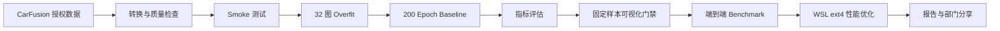

# YOLOv10 Vehicle Pose：用 Codex 构建车辆关键点训练系统

基于 [THU-MIG/YOLOv10](https://github.com/THU-MIG/yolov10) 扩展的车辆检测与关键点训练系统，面向 CarFusion 单类车辆数据。项目覆盖数据转换与质检、14×3 Pose Head、训练门禁、断点恢复、精度评估、可视化验收、端到端性能分析及部门分享材料。

> 数据集不在本仓库中。代码、配置、测试、模型权重、实验报告、可视化结果、PPT、演讲稿和 Codex 提示词均已纳入版本管理。

## 结果概览

训练环境为 WSL2 + RTX 3090 Ti，YOLOv10n Vehicle Pose，`imgsz=640`、`batch=16`、200 epochs。

| 指标 | 结果 |
|---|---:|
| 验证集 | 3,606 images / 11,569 instances |
| Box mAP50 / mAP50-95 | 0.818 / 0.665 |
| Pose mAP50 / mAP50-95 | 0.765 / 0.515 |
| PCK@0.05 / PCK@0.10 | 0.6686 / 0.8525 |
| NME | 0.05960 |
| E 盘到 WSL ext4 端到端延迟 | 60.10 → 16.63 ms |
| 系统吞吐提升 | 3.61×，不改变模型与精度 |

完整验收结论见 [reports/09_final_acceptance.md](reports/09_final_acceptance.md)。


## 系统流程



训练按 `smoke → overfit → baseline` 推进：先验证链路可运行，再验证模型能在小样本上学习，最后才投入完整训练。Codex 心跳负责定期读取实际进程、GPU、日志、epoch 与结果文件，遇到安全的项目内问题自动修复并续跑，避免重复任务。

## 主要改动

- 原生 `14×3` 车辆关键点 Pose Head。
- 保留 YOLOv10 one-to-many / one-to-one 双分配训练语义。
- 推理使用 one-to-one NMS-free 路径。
- CarFusion 确定性转换、分组切分、异常 bbox 策略与可视化质检。
- PCK、NME、可见/遮挡、单关键点及车辆尺度分组指标。
- 测试先行修复 predictor 的 `xywh → xyxy` 框缩放问题。
- PyTorch model-only、端到端 benchmark 与 profiler。
- 独立 WSL ext4 数据暂存方案，不修改 baseline 代码、权重或结果。

## 快速开始

```bash
git clone git@github.com:Caius-Lu/yolov10-vehicle-pose.git
cd yolov10-vehicle-pose
python3 -m venv .venv
.venv/bin/python -m pip install -r requirements.txt
.venv/bin/python -m pip install --no-build-isolation -e . pytest
```

仓库已包含官方 YOLOv10n 预训练权重和本项目的 baseline / 实验 checkpoint：

- `weights/yolov10n.pt`
- `outputs/baseline_weights/best.pt`
- `outputs/baseline_weights/last.pt`
- `outputs/network_optimization/yolov10n_pose_distilled_512_3e_best.pt`

## 数据准备

CarFusion 数据需自行取得授权并放在本地或远程数据目录，禁止提交原始图片、标签归档、Token 或私密下载链接。

```bash
scripts/run_carfusion_pipeline.sh
```

该入口依次完成 COCO 整理、YOLO Pose 转换、质量检查、固定切分和预览生成。详细说明见 [docs/dataset.md](docs/dataset.md)。

## 训练与恢复

```bash
scripts/train_vehicle_pose_smoke.sh
scripts/train_vehicle_pose_overfit.sh
scripts/train_vehicle_pose_full.sh
scripts/resume_vehicle_pose.sh path/to/last.pt
```

最终 baseline 在 WSL 重启和 Windows E 盘临时丢失后，从 epoch 176 的 `last.pt` 恢复并完成 200 epochs，没有重启实验。训练证据见 [reports/training/06_baseline_report.md](reports/training/06_baseline_report.md)。

## 评估与可视化门禁

```bash
.venv/bin/yolo pose val \
  model=outputs/baseline_weights/best.pt \
  data=ultralytics/cfg/datasets/CarFusion-pose.yaml \
  device=0

.venv/bin/python scripts/evaluate_vehicle_pose.py \
  --pairs-json reports/training/matched_pose_pairs.json
```

固定样本会同时检查 GT、预测框、关键点和置信度。可视化门禁发现并修复了宽图上预测框过大的问题；修复后的代表性结果位于 [reports/visualization/review_boxfix](reports/visualization/review_boxfix)。


## 性能 Benchmark 与优化

```bash
scripts/benchmark_torch.sh --checkpoint outputs/baseline_weights/best.pt
scripts/benchmark_end_to_end.sh --checkpoint outputs/baseline_weights/best.pt
scripts/profile_torch.sh --checkpoint outputs/baseline_weights/best.pt
```

当前首选优化不是蒸馏，而是将转换后的数据从 `/mnt/e` 暂存到 WSL Linux 文件系统：

```bash
scripts/stage_carfusion_to_wsl.sh \
  datasets/CarFusion/yolo_pose \
  /home/caius/datasets/CarFusion/yolo_pose \
  reports/optimization/runtime_configs/CarFusion-pose-wsl.yaml
```

相同模型、权重、精度与 100 张固定图片下，端到端平均延迟从 60.10 ms 降至 16.63 ms。完整边界和证据见 [reports/optimization/08_final_recommendation.md](reports/optimization/08_final_recommendation.md)。蒸馏实验保留为研究记录，但因没有产生部署延迟收益而未作为推荐方案。

## 测试

```bash
DEVICE=cuda:0 IMGSZ=640 scripts/validate_project.sh
```

最终远程验收中，全量 pytest 通过，Vehicle Pose 回归测试为 9/9。测试源码位于 [tests](tests)。

## 文档与分享材料

- [完整项目用法](README_VEHICLE_POSE.md)
- [系统架构](docs/architecture.md)
- [训练说明](docs/training.md)
- [评估说明](docs/evaluation.md)
- [性能优化说明](docs/optimization.md)
- [Codex 构建训练系统部门分享底稿](docs/部门分享_从YOLOv10到车辆关键点训练系统.md)
- [最终版 PPT](outputs/Codex构建YOLOPose训练系统_部门分享_最终版.pptx)
- [完整演讲稿](outputs/Codex构建YOLOPose训练系统_完整演讲稿.md)
- [Codex 提示词压缩包](yolov10_vehicle_pose_codex_prompts.zip)

## 已知数据边界

模型接口保持 `14×3`，但当前 CarFusion 源数据中关键点索引 13 在全部 62,434 个实例里可见性均为 0，因此只有 13 个点具备有效监督和评估证据。完整左右语义映射确认前，训练保持 `fliplr=0.0`。

## 上游与许可证

本项目基于 [YOLOv10](https://github.com/THU-MIG/yolov10) 和 Ultralytics 代码扩展。请同时遵守原项目许可证、CarFusion 数据授权条款及仓库中的 [LICENSE](LICENSE)。
