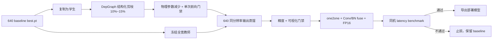

# YOLOv10 Vehicle Pose 结构化剪枝与恢复蒸馏

本方案是一个**独立实验分支**：从已验收的 640 baseline 复制学生模型，做保守的通道结构化剪枝，再用原 baseline 作为冻结教师进行短周期恢复训练。它不会修改 baseline 代码、权重、数据集或既有报告，也不会把“蒸馏提升精度”误当成“部署一定加速”。最终是否采用，只由同一硬件上的精度与实测延迟门禁决定。

## 为什么是结构化剪枝

权重置零或非结构化稀疏通常不会直接减少普通 CUDA dense kernel 的张量尺寸，因此未必产生部署收益。本实现使用 [Torch-Pruning DepGraph](https://github.com/VainF/Torch-Pruning) 追踪耦合通道，并物理删除 Conv/BN 相关维度。剪枝后参数形状改变，checkpoint 必须保存完整模型对象；加载陌生来源的 whole-model checkpoint 存在反序列化风险，只加载本项目自己生成且来源可信的文件。

这里保护检测与姿态头的最终输出层，固定：

- DFL 框输出：`4 × reg_max = 64` 通道；
- 分类输出：`nc = 1` 通道；
- 关键点输出：`14 × 3 = 42` 通道；
- one-to-many 与 one-to-one 两套分支都受保护。

仅选择无静态 split 属性的保守 Conv 作为剪枝根节点，依赖图负责同步调整下游输入、BN 和 depthwise 耦合通道。默认只剪 15%，并将通道对齐到 8，兼顾 Tensor Core/部署后端的友好尺寸。

## 实现结构



相关文件：

- `ultralytics/models/yolov10/prune_distill.py`：剪枝、输出蒸馏及 whole-model checkpoint；
- `scripts/prune_vehicle_pose.py`：数据无关的结构剪枝入口；
- `scripts/train_pose_pruned_distillation.py`：加载已变形学生并恢复训练；
- `configs/pose_prune_distill.yaml`：20-epoch 研究配置；
- `configs/pose_prune_distill_100e.yaml`：已经远程验证的 100-epoch、batch=64 配置；
- `tests/test_pose_pruning_distillation.py`：结构与梯度边界；
- `tests/test_pose_pruning_pipeline.py`：路径和配置安全边界。

## 运行步骤

安装可选依赖：

```bash
.venv/bin/python -m pip install --no-deps -r requirements-pruning.txt
```

第一步只构建依赖图并生成初始剪枝模型，不读取数据集：

```bash
.venv/bin/python scripts/prune_vehicle_pose.py \
  --checkpoint outputs/baseline_weights/best.pt \
  --output outputs/pruning/yolov10n_pose_pruned15_init.pt \
  --report reports/pruning/prune15_structure.json \
  --graph-imgsz 64 \
  --pruning-ratio 0.15 \
  --round-to 8 \
  --device cuda
```

`graph-imgsz=64` 只用于追踪全卷积网络的通道依赖和做一次前向检查，不代表训练或验证分辨率。训练、教师和最终评估仍为 640。默认不做额外 MAC 统计，避免在构图阶段重复执行高内存 profile；如确有需要可显式加 `--measure-macs`。参数减少是结构门禁，真实速度必须用现有 benchmark 测量。

第二步做恢复蒸馏。短周期研究使用原配置；复现本次完整实验使用 100-epoch 配置：

```bash
.venv/bin/python scripts/train_pose_pruned_distillation.py \
  --config configs/pose_prune_distill_100e.yaml
```

学生继续接受真实 bbox、类别、14×3 关键点监督；教师只提供同分辨率 raw-output 软目标：DFL 分布 KL、分类/visibility 概率 MSE、关键点 XY SmoothL1。这样允许学生隐藏通道宽度变化，而最终输出语义保持一致。教师不注册为学生子模块，不进入 optimizer、EMA 或 checkpoint。

只做链路验证时，必须使用显式的小范围参数，并使用独立输出名：

```bash
.venv/bin/python scripts/train_pose_pruned_distillation.py \
  --config configs/pose_prune_distill.yaml \
  --epochs 1 --batch 2 --fraction 0.002 \
  --name carfusion_prune15_kd_smoke
```

该命令只是训练链路 smoke，不产生可用于决策的精度结论。

## 分阶段实验与止损门禁

不要一次批量跑 10%/15%/20% 三组。按下面顺序推进，每一组通过后再启动下一组：

1. **10% 剪枝**：验证结构、恢复能力和真实 latency 是否有方向性收益；
2. **15% 剪枝**：默认推荐候选，完整执行 20 epoch 恢复与验证；
3. **20% 剪枝**：仅当 15% 的精度余量和延迟收益都明显时考虑。

15% 候选的建议通过条件：

| 门禁 | 条件 |
|---|---:|
| 物理参数量 | 至少减少 10% |
| FP16 fused model-only latency | 相对现有 FP16 fused baseline 至少降低 10% |
| Pose mAP50-95 | 下降不超过 0.005 |
| PCK@0.05 | 下降不超过 0.005 |
| PCK@0.10 | 下降不超过 0.002 |
| NME | 增加不超过 0.001 |
| 可视化 | 固定 100 图无系统性错位、漏点或置信度退化 |

任何一项失败，都不覆盖 baseline，也不进入部署推荐。尤其是：即使蒸馏把精度恢复回来，如果同硬件、同 batch、同预处理和同后处理条件下 latency 没有改善，就判定该剪枝方案没有部署收益并停止。

## 评估与部署顺序

1. 对恢复后的 `best.pt` 跑完整 3,606 图验证，生成 Box/Pose mAP、PCK、NME；
2. 用与 baseline 完全相同的固定 100 图执行可视化门禁；
3. 先测 PyTorch FP32，再测 one-to-one-only + fuse + FP16；
4. 只有 PyTorch 门禁通过，才导出 ONNX/TensorRT，并重新核对输出和精度；
5. 把结构报告、训练配置、checkpoint SHA-256、指标和延迟结果存入新的 `reports/pruning/<experiment>/`，禁止覆盖已有结果。

## 已完成的 100-epoch 远程验证

2026-07-23 至 2026-07-24 在 `wsl-dev` 的 RTX 3090 Ti 上完成了 15% 结构化剪枝与 batch=64、100 epoch 恢复蒸馏，训练用时 3.81 小时。依赖图实际选取 53 个保守根层，73 个 Conv 只允许被依赖传播调整，18 个最终输出层受保护。训练未发生 OOM 或非有限 loss。

| 指标 | 200e baseline | 剪枝 + KD 100e | 变化 |
|---|---:|---:|---:|
| 参数量 | 4,005,986 | 3,350,666 | -16.36% |
| checkpoint | 8.42 MB | 7.06 MB | -16.20% |
| Box mAP50-95 | 0.66761 | 0.57041 | -0.09720 |
| Pose mAP50-95 | 0.51455 | 0.41532 | -0.09923 |
| PCK@0.05 | 0.66863 | 0.60902 | -0.05960 |
| PCK@0.10 | 0.85248 | 0.81319 | -0.03930 |
| NME | 0.05960 | 0.07291 | +0.01331 |
| fused FP16 latency | 5.7010 ms | 5.6819 ms | -0.34% |

计时严格使用同一设备、batch=1、640、one-to-one-only、Conv/BN fuse、FP16、100 次 warmup、1000 次计时和 3 轮平均。剪枝候选自身从 FP32 切换到 FP16 的加速不等于剪枝收益；部署决策看的是两个模型各自 fused FP16 的横向比较。

结果只通过参数量门禁，精度与 latency 门禁失败，因此不能替换 baseline。完整原始证据在：

- `reports/pruning/r2/prune15_structure_20260723.json`
- `reports/pruning/r2/results.csv`
- `reports/pruning/r2/vehicle_pose_metrics.json`
- `reports/pruning/r2/comparison.json`
- `reports/benchmark/prune15_kd100_r2/`

训练曲线显示 Box/Pose/PCK 分别在 epoch 14、24、30–31 左右达到最佳，之后训练 loss 仍下降而验证指标不再改善。因此“再增加 epoch”不是当前证据支持的修复。第二阶段应优先保护 Pose/Detect head 的敏感根层、使用分层剪枝率和硬件友好的通道对齐，并在独立配置和输出目录中先通过小规模精度与延迟门禁。

## 失败恢复与安全边界

1. 每个实验使用唯一 `name`、PID、日志和输出目录，存活时禁止重复启动；
2. OOM 时只降低 batch 并新建 run，不复用半写入目录；
3. whole-model checkpoint 只能加载本仓库自产且来源可信的文件；
4. baseline 权重、数据 YAML、转换后数据和既有报告全部只读；
5. 若参数减少但 latency 无改善，立即判定部署收益失败；若精度恢复但 latency 失败，也不得推荐上线。

## 第二阶段：Head 保护修复与训练前止损

第一阶段的 53 个剪枝根中有 36 个位于 Detect/Pose Head，Head 参数占总模型 53.9%。结合 Pose mAP、PCK 在 epoch 24–31 早期达峰后不再恢复的证据，第二阶段不再增加 epoch，而是新增 `head_pruning_ratio`，允许 Head 隐藏塔独立保护。

独立候选使用 Backbone/Neck 20%、Head 0%、`round_to=16`。TDD 过程先得到 3 个预期失败，完成实现后 15 项聚焦测试通过。真实结构与训练前 benchmark 为：

| 指标 | Baseline | Head 保护候选 | 变化 |
|---|---:|---:|---:|
| 参数量 | 4,005,986 | 3,817,154 | -4.71% |
| fused FP16 latency | 5.7010 ms | 5.9229 ms | +3.89%（更慢） |

候选没有达到参数减少 10% 和 latency 降低 10% 的预训练门禁，因此没有启动恢复训练。训练可以改变权重和精度，不能改变已经测得更慢的执行图；继续消耗 epoch 与本实验的加速目标无关。

复现命令：

```bash
.venv/bin/python scripts/prune_vehicle_pose.py \
  --checkpoint vehicle_pose_runs/carfusion_baseline_yolov10n_e_drive_20260718/weights/best.pt \
  --output outputs/pruning/yolov10n_pose_prune20_head0_r16_init_20260724.pt \
  --report reports/pruning/repair_prune20_head0_r16_init_20260724.json \
  --graph-imgsz 64 --pruning-ratio 0.20 \
  --head-pruning-ratio 0 --round-to 16 --device cuda
```

配置与证据位于 `configs/pose_prune_repair_gate.yaml`、`reports/pruning/repair_head_protected/` 和 `reports/benchmark/repair_prune20_head0_r16/`。

## 第三阶段：FastHead 显式结构搜索

结构化剪枝证明了 nano 级模型缺少可随意删除的冗余后，第三阶段不再让依赖图任意选择通道，而是显式缩短 Pose/Box 输出塔。固定 Backbone、Neck、DFL/分类/关键点输出维度和 YOLOv10 双分配语义，只搜索 Pose Tower 宽度、深度及 Box Tower 深度。

训练前共测试七组结构：

| Pose / Box 结构 | 参数下降 | GFLOPs 下降 | fused FP16 延迟下降 | 结论 |
|---|---:|---:|---:|---|
| 96×2 / Box×2 baseline | 0% | 0% | 0% | 参照 |
| 96×1 / Box×2 | 12.45% | 14.92% | 1.69% | FAIL |
| 64×2 / Box×2 | 13.56% | 12.94% | 2.18% | FAIL |
| 64×1 / Box×2 | 19.10% | 19.59% | 3.15% | FAIL |
| 96×1 / Box×1 | 17.99% | 21.57% | 3.09% | FAIL |
| 64×1 / Box×1 | 24.64% | 26.24% | 6.51% | PASS，允许训练 |
| 32×1 / Box×1 | 31.30% | 30.90% | 4.53% | FAIL，更小但更慢 |

该结果表明，参数量和 FLOPs 只能描述工作量，不能单调预测 GPU 延迟。通道是否对齐目标硬件、每层算子规模、Kernel 启动次数、访存与算术强度都会改变最终速度。

复现训练前门禁：

```bash
.venv/bin/python -m benchmarks.pretrain_architecture_gate \
  --baseline ultralytics/cfg/models/v10/yolov10n-vehicle-pose.yaml \
  --candidate fasthead=ultralytics/cfg/models/v10/yolov10n-vehicle-pose-fasthead-boxd1.yaml \
  --device cuda:0 --imgsz 640 --warmup 100 --iterations 1000 --rounds 3 \
  --output reports/benchmark/fasthead_gate/reproduce.json
```

## FastHead 有界自适应训练与 TDD 恢复

FastHead 先执行 1-epoch smoke 验证 AMP、KD、反向、验证和 checkpoint 保存，再运行 10e 精度门禁。只有最佳点靠近末尾且 Box/Pose/PCK/NME 与 loss 提供一致的上升证据时，才使用独立 checkpoint、配置、run 名和输出目录追加训练：

1. 10e：Pose mAP50-95 达 0.3181，末四轮仍上升，允许追加 20e；
2. 首次 r2 在首 batch 前安全失败：whole-model checkpoint 缓存的 `criterion` 仍在 CPU；
3. 先新增回归测试，再在 `upgrade_for_pruning_distillation` 的设备迁移前丢弃陈旧 `criterion`，21 项聚焦测试通过；
4. r3 累计 30e：Pose 0.3631、Box 0.5428、NME 0.0781，末五轮仍改善；
5. r4 追加最后 20e，累计 50e 达到硬上限，不再续训。

这个策略不是“自动追着最好结果不停训练”，而是一个有限状态机：每次续训都有证据、有独立产物、有总轮数上限；平台化、回落、OOM/NaN 或精度收益不足时立即停止。

## FastHead 50e 最终结果

| 指标 | 200e baseline | FastHead 50e | 变化 |
|---|---:|---:|---:|
| 参数量 | 4,005,986 | 3,018,722 | -24.64% |
| fused 参数量 | 3,992,210 | 3,006,098 | -24.70% |
| checkpoint | 8.42 MB | 6.10 MB | -27.55% |
| Box mAP50-95 | 0.66761 | 0.55303 | -0.11458 |
| Pose mAP50-95 | 0.51455 | 0.37569 | -0.13886 |
| PCK@0.05 | 0.66863 | 0.56017 | -0.10846 |
| PCK@0.10 | 0.85248 | 0.80219 | -0.05029 |
| NME | 0.05960 | 0.07635 | +0.01675 |
| fused FP16 latency | 5.6955 ms | 5.3314 ms | -6.39% |

计时条件完全一致：RTX 3090 Ti、640、batch1、one-to-one-only、Conv/BN fuse、FP16、100 次 warmup、3×1000 次。FastHead 只通过参数和速度门禁，未通过精度门禁，因此不替换 200e baseline。

## 为什么精度下降明显

“模型本身已经很小”是主要原因，但不是唯一原因：

- baseline 仅约 4.0M 参数，冗余远少于中大型模型；FastHead 一次减少 24.64% 总参数；
- Head 是关键点定位、可见性与框回归的高敏感区域，容量下降直接影响细粒度空间表达；
- 结构改变后只能迁移同形权重，新隐藏层无法完整继承 baseline 表示；
- 当前 KD 以输出为主，不能完整补偿中间特征、几何关系和关键点局部结构；
- 50e 曲线虽仍有学习信号，但精度差距已远大于门禁，继续堆 epoch 不符合成本和风险边界；
- 32 通道候选更小却更慢，说明 GPU Kernel 和通道对齐同时限制了“继续缩头”的部署收益。

## 具体耗时瓶颈

绝对延迟使用无 Hook 的正式 benchmark；模块级 CUDA Event 会引入插桩开销，因此只用于阶段占比。顶层模块剖析如下：

| 阶段 | Baseline | FastHead | FastHead 占比 |
|---|---:|---:|---:|
| Backbone | 2.9275 ms | 2.6824 ms | 44.92% |
| Neck | 1.6575 ms | 1.5957 ms | 26.72% |
| Detect + Pose Head | 2.1431 ms | 1.6933 ms | 28.36% |

FastHead 中 Backbone + Neck 合计 71.64%，已经成为主瓶颈；Head 仍是最大单模块。Head 参数从 2.156M 降至 1.170M，减少 45.73%，但 Head 模块时间只减少约 20.99%。这说明剩余延迟受访存、小 Kernel 启动、算子调度和硬件利用率影响，不能继续按参数比例估算。

下一轮可行优先级：

1. 在独立配置中验证 PSA 与 C2f/C2fCIB 的轻量替换，并保持关键点 Head 容量；
2. 导出 TensorRT 后检查层融合、Kernel 选择和 FP16 Tensor Core 对齐；
3. 对 Backbone/Neck 候选继续执行“参数/FLOPs/真实延迟/完整精度”四门禁；
4. 若继续蒸馏，增加特征与几何蒸馏，但只有结构本身先通过延迟门禁才值得训练。

复现模块级占比（该结果不作为正式绝对延迟）：

```bash
.venv/bin/python benchmarks/profile_module_latency.py \
  --checkpoint /path/to/best.pt \
  --device cuda:0 --imgsz 640 --warmup 100 --iterations 200 \
  --output reports/benchmark/module_profile_fp16.json
```

原始证据位于 `reports/benchmark/fasthead_final_50e/`、`reports/fasthead/final_50e/`，汇总见 `reports/fasthead/final_50e/final_report.md`。
