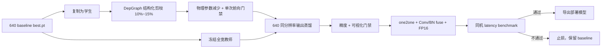

# YOLOv10 Vehicle Pose 结构化剪枝与恢复蒸馏

本方案是一个**独立实验分支**：从已验收的 640 baseline 复制学生模型，做保守的通道结构化剪枝，再用原 baseline 作为冻结教师进行短周期恢复训练。它不会修改 baseline 代码、权重、数据集或既有报告，也不会把“蒸馏提升精度”误当成“部署一定加速”。最终是否采用，只由同一硬件上的精度与实测延迟门禁决定。

## 为什么是结构化剪枝

权重置零或非结构化稀疏通常不会直接减少普通 CUDA dense kernel 的张量尺寸，因此未必产生部署收益。本实现使用 [Torch-Pruning DepGraph](https://github.com/VainF/Torch-Pruning) 追踪耦合通道，并物理删除 Conv/BN 相关维度。剪枝后参数形状改变，checkpoint 必须保存完整模型对象；加载陌生来源的 whole-model checkpoint 存在反序列化风险，只加载本项目自己生成且来源可信的文件。

这里保护检测与姿态头的最终输出层，固定：

- DFL 框输出：`4 × reg_max = 64` 通道；
- 分类输出：`nc = 1` 通道；
- 关键点输出：`14 × 3 = 42` 通道；
- one-to-many 与 one-to-one 两套分支都受保护。

仅选择无静态 split 属性的保守 Conv 作为剪枝根节点，依赖图负责同步调整下游输入、BN 和 depthwise 耦合通道。默认只剪 15%，并将通道对齐到 8，兼顾 Tensor Core/部署后端的友好尺寸。

## 实现结构



相关文件：

- `ultralytics/models/yolov10/prune_distill.py`：剪枝、输出蒸馏及 whole-model checkpoint；
- `scripts/prune_vehicle_pose.py`：数据无关的结构剪枝入口；
- `scripts/train_pose_pruned_distillation.py`：加载已变形学生并恢复训练；
- `configs/pose_prune_distill.yaml`：独立实验配置；
- `tests/test_pose_pruning_distillation.py`：结构与梯度边界；
- `tests/test_pose_pruning_pipeline.py`：路径和配置安全边界。

## 运行步骤

安装可选依赖：

```bash
.venv/bin/python -m pip install --no-deps -r requirements-pruning.txt
```

第一步只构建依赖图并生成初始剪枝模型，不读取数据集：

```bash
.venv/bin/python scripts/prune_vehicle_pose.py \
  --checkpoint outputs/baseline_weights/best.pt \
  --output outputs/pruning/yolov10n_pose_pruned15_init.pt \
  --report reports/pruning/prune15_structure.json \
  --graph-imgsz 64 \
  --pruning-ratio 0.15 \
  --round-to 8 \
  --device cuda
```

`graph-imgsz=64` 只用于追踪全卷积网络的通道依赖和做一次前向检查，不代表训练或验证分辨率。训练、教师和最终评估仍为 640。默认不做额外 MAC 统计，避免在构图阶段重复执行高内存 profile；如确有需要可显式加 `--measure-macs`。参数减少是结构门禁，真实速度必须用现有 benchmark 测量。

第二步做 20 epoch 的低学习率恢复蒸馏：

```bash
.venv/bin/python scripts/train_pose_pruned_distillation.py \
  --config configs/pose_prune_distill.yaml
```

学生继续接受真实 bbox、类别、14×3 关键点监督；教师只提供同分辨率 raw-output 软目标：DFL 分布 KL、分类/visibility 概率 MSE、关键点 XY SmoothL1。这样允许学生隐藏通道宽度变化，而最终输出语义保持一致。教师不注册为学生子模块，不进入 optimizer、EMA 或 checkpoint。

只做链路验证时，必须使用显式的小范围参数，并使用独立输出名：

```bash
.venv/bin/python scripts/train_pose_pruned_distillation.py \
  --config configs/pose_prune_distill.yaml \
  --epochs 1 --batch 2 --fraction 0.002 \
  --name carfusion_prune15_kd_smoke
```

该命令只是训练链路 smoke，不产生可用于决策的精度结论。

## 分阶段实验与止损门禁

不要一次批量跑 10%/15%/20% 三组。按下面顺序推进，每一组通过后再启动下一组：

1. **10% 剪枝**：验证结构、恢复能力和真实 latency 是否有方向性收益；
2. **15% 剪枝**：默认推荐候选，完整执行 20 epoch 恢复与验证；
3. **20% 剪枝**：仅当 15% 的精度余量和延迟收益都明显时考虑。

15% 候选的建议通过条件：

| 门禁 | 条件 |
|---|---:|
| 物理参数量 | 至少减少 10% |
| FP16 fused model-only latency | 相对现有 FP16 fused baseline 至少降低 10% |
| Pose mAP50-95 | 下降不超过 0.005 |
| PCK@0.05 | 下降不超过 0.005 |
| PCK@0.10 | 下降不超过 0.002 |
| NME | 增加不超过 0.001 |
| 可视化 | 固定 100 图无系统性错位、漏点或置信度退化 |

任何一项失败，都不覆盖 baseline，也不进入部署推荐。尤其是：即使蒸馏把精度恢复回来，如果同硬件、同 batch、同预处理和同后处理条件下 latency 没有改善，就判定该剪枝方案没有部署收益并停止。

## 评估与部署顺序

1. 对恢复后的 `best.pt` 跑完整 3,606 图验证，生成 Box/Pose mAP、PCK、NME；
2. 用与 baseline 完全相同的固定 100 图执行可视化门禁；
3. 先测 PyTorch FP32，再测 one-to-one-only + fuse + FP16；
4. 只有 PyTorch 门禁通过，才导出 ONNX/TensorRT，并重新核对输出和精度；
5. 把结构报告、训练配置、checkpoint SHA-256、指标和延迟结果存入新的 `reports/pruning/<experiment>/`，禁止覆盖已有结果。

## 当前证据边界

仓库已完成剪枝/恢复蒸馏代码、保护层测试、梯度隔离测试、路径安全测试和快速单元测试。远程 11 项聚焦测试通过；一次 64×64、单张虚拟输入的真实 DepGraph smoke 在 90 秒资源上限内未完成并被终止，因此没有生成剪枝权重。尚未运行 CarFusion 剪枝恢复训练，本页不声明任何新的精度或延迟数字。首次真实剪枝也应作为受监控实验单独授权，不能当作无成本 smoke；后续完整实验需逐组运行。
